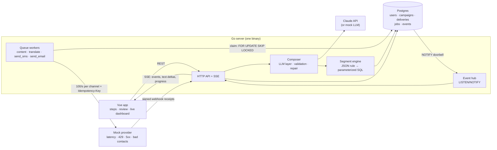

# Smart Campaign Composer

A marketer describes a campaign in plain language. Claude turns it into a validated audience segment and
SMS/email copy. The marketer reviews and approves once. The system then sends through a rate-limited queue to a
mock provider, and a dashboard shows delivery status live.

Go backend, Postgres, Vue 3 frontend. The reasons behind each choice are in [DECISIONS.md](DECISIONS.md). The
original phased plan is in [docs/PLAN.md](docs/PLAN.md).

## Quick start

```bash
docker compose up
```

Open http://localhost:8080. This runs the web app, API, workers, Postgres and the mock provider. Without an API
key the server uses a **mock LLM**, so the whole flow works offline.

To use Claude, create `.env` before starting:

```bash
cp .env.example .env   # then set ANTHROPIC_API_KEY (and ANTHROPIC_WORKSPACE_ID if your key is workspace-scoped)
```

| Command      | What it does                                  |
| ------------ | --------------------------------------------- |
| `make up`    | Build and start everything with Docker Compose |
| `make test`  | All Go and frontend tests. No API key, Docker or network needed |
| `make run`   | Run the API locally with embedded Postgres (serves `web/dist` if built) |
| `make web`   | Frontend dev server with hot reload on :5173 (proxies the API on :8080) |
| `make session IN=<zip> NAME=<name>` | Scrub a Claude session export into `ai-sessions/` ([how](ai-sessions/README.md)) |

`make run` and `make test` need Go 1.27 and Node 22. Without `DATABASE_URL` the server starts an embedded
Postgres under `.data/`.

### Services

| Service | Port | Notes |
| --- | --- | --- |
| `server` | 8080 | Web app, API, workers, `/healthz`, `/readyz`, `/metrics` |
| `mockprovider` | 9090 | Fake SMS/email provider; `GET /stats` shows what it saw |
| `postgres` | 55432 | `composer` / `composer` (local only) |

## How it works



One campaign, end to end:

1. **Brief.** `POST /api/campaigns` stores the brief.
2. **Audience.** Claude returns a segment rule as JSON, using structured outputs with a schema built from the
   field catalog. The server validates it, and on problems sends them back for one repair round. It then
   compiles the rule to parameterized SQL and previews the audience size and samples.
3. **Messages.** A queue job asks Claude for SMS, email subject and email body, informed by the audience's conditions in plain
   words (for example "no purchase in the last 60 days"). The text streams to the browser field by field as it is written. It is validated
   against length limits and allowed variables, with the same repair loop. If users in the audience speak other
   languages, one translation per language is queued.
4. **Review and approve.** The marketer sees the rule as chips, the audience count, previews rendered for real
   recipients, and SMS length and parts. They can edit anything, and then approve once, now or at a scheduled
   time.
5. **Send.** Approval inserts every delivery and every send job in one transaction. Workers send at up to 100
   messages/s per channel, retry temporary errors, and fail invalid contacts at once.
6. **Track.** The provider posts signed receipts (`delivered` / `undelivered`). The dashboard shows counts,
   throughput, retries and a pixel grid of every delivery, updated live over SSE. Failed or undelivered messages
   can be sent again as a new round.

## Requirements and where they are met

| Requirement | How |
| --- | --- |
| LLM output never becomes raw SQL | The LLM returns a JSON rule (`internal/segment`). Fields, operators and value types come from one catalog. The compiler emits only parameterized SQL with whitelisted columns. Invalid rules are rejected with path-labelled problems. |
| Structured LLM output, validated | Structured outputs via `output_config.format`, JSON Schema generated from Go types (`internal/schema`). Everything is still validated server-side, with a repair round that lists the problems. |
| Message limits and variables | SMS 160 characters, subject 80 characters, checked at the **worst case**: the longest first name, last name and city in this audience. Only `{{first_name}}`, `{{last_name}}`, `{{city}}` are allowed. GSM-7 vs UCS-2 parts are shown (`internal/message`). |
| Async queue | Postgres jobs table (`internal/queue`): `SKIP LOCKED` claims, leases, a sweeper for crashed workers, dedup keys, `run_at` for delays and schedules. |
| 100 msg/s per channel | A token bucket per channel (burst 1), with its own worker pool per channel. A test checks that no one-second window goes over. |
| Never the same message twice | Four layers: `UNIQUE(campaign_id, user_id, channel)`, one job per delivery under a dedup key, workers skip finished deliveries, and an `Idempotency-Key` the provider honours. A chaos test with lost responses, 429s and 5xx checks exactly-once. |
| Retries | 429, 5xx and network errors back off exponentially with jitter, or honour `Retry-After`, for up to 6 attempts. Invalid contacts fail permanently, at once. |
| Live status | SSE per campaign: stored events with `Last-Event-ID` replay, message deltas, and progress snapshots at most every 500 ms, woken by a throttled Postgres `NOTIFY`. |
| Metrics and health | `/healthz` (process up), `/readyz` (database reachable), and Prometheus `/metrics`: provider calls and latency, deliveries, webhooks, LLM calls and tokens by task, queue depth. |
| Tests with a mock LLM | `internal/llm/llmtest` scripts replies, errors and streams. The API tests run the whole flow against real Postgres (one database per test), the mock provider and the fake LLM. |

## Configuration

All optional. Docker Compose sets the database, provider and webhook values for you.

| Variable | Default | |
| --- | --- | --- |
| `ANTHROPIC_API_KEY` | (empty → mock LLM) | |
| `ANTHROPIC_WORKSPACE_ID` | (empty) | Needed for workspace-scoped keys |
| `ANTHROPIC_MODEL` | `claude-haiku-5-5` | See [DECISIONS › Models](DECISIONS.md#models) |
| `DATABASE_URL` | (empty → embedded Postgres in `DATA_DIR`) | Must be a UTF8 database |
| `DATA_DIR` | `.data` | |
| `PORT` | `8080` | |
| `PROVIDER_URL` | `http://localhost:9090` | Mock provider |
| `WEBHOOK_SECRET` | a dev-only value | Shared with the provider for receipt signatures |
| `SEND_RATE_PER_SECOND` | `100` | Per channel |
| `SEND_WORKERS` | `40` | Per channel |
| `SEED_USERS` | `5000` | Mock users created on first start (deterministic) |
| `WEB_DIR` | `web/dist` | Built frontend to serve |
| `LOG_FORMAT` | `text` | `json` in Docker |

The mock provider's misbehaviour (latency, 429/5xx rates, lost responses, receipt delays) is set by its own
variables in [cmd/mockprovider/main.go](cmd/mockprovider/main.go).

## Testing

```bash
make test
```

- **Go:** `go test -race ./...`. Tests use an embedded Postgres, one fresh database per test, with binaries cached
  after the first run. Coverage includes the segment compiler and validation, templates and SMS encoding, queue
  semantics (leases, sweeper, dedup, backoff), SSE replay, LLM retry and repair, and full API flows. These include
  chaos sending, the rate limit, receipts, resend, scheduling and per-user language.
- **Frontend:** `vue-tsc` type check and Vitest for rule, SMS and stream helpers.
- **CI:** [GitHub Actions](.github/workflows/ci.yml) runs vet, gofmt, the Go tests with `-race`, the frontend
  checks and tests, and the Docker build.

## API

| Endpoint | Purpose |
| --- | --- |
| `POST /api/campaigns` | Create a campaign from a brief |
| `GET /api/campaigns`, `GET /api/campaigns/{id}` | List / read campaigns |
| `POST /api/campaigns/{id}/audience` | Generate the audience rule with the LLM (messages follow automatically) |
| `POST /api/campaigns/{id}/audience/refine` | Change the rule with an instruction |
| `PUT /api/campaigns/{id}/audience` | Save a hand-edited rule |
| `POST /api/campaigns/{id}/content` | Regenerate messages (streams to `/events`) |
| `PUT /api/campaigns/{id}/content` | Save hand-edited messages |
| `POST /api/campaigns/{id}/approve` | Queue one delivery per consenting recipient and channel; `{"send_at": …}` schedules it |
| `POST /api/campaigns/{id}/unschedule` | Cancel a scheduled campaign before it starts |
| `POST /api/campaigns/{id}/resend` | Send again what did not arrive (a new round; invalid contacts skipped) |
| `GET /api/campaigns/{id}/events` | Server-sent events: status changes, message text as it is written, delivery progress |
| `GET /api/campaigns/{id}/deliveries[/counts]` | Delivery list (filter by `status`) and counts |
| `GET /api/segments/fields`, `POST /api/segments/preview` | Rule fields; preview counts for a rule |
| `GET /api/deliveries/recent` | Status codes of the latest deliveries (the home page band) |
| `POST /webhooks/provider` | Signed delivery receipts from the provider |

Errors are JSON: `{"error": {"code": …, "message": …}}`, plus `"problems": [...]` when validation fails.

## Project layout

```
cmd/server            API, workers and web app in one binary
cmd/mockprovider      fake SMS/email provider with signed receipts
internal/api          HTTP handlers, SSE streams, webhooks, middleware
internal/campaign     campaign lifecycle: audience, content, approve, schedule, resend, progress, translations
internal/composer     prompts and LLM calls for audience, messages and translation; streaming field extractor; mock LLM
internal/segment      rule model, field catalog, validation, SQL compiler, preview, plain-language description
internal/message      templates: variables, rendering, worst-case length, GSM-7/UCS-2
internal/delivery     sender (rate limit, retries, idempotency), provider client, receipts
internal/queue        Postgres job queue and workers
internal/events       event log, LISTEN/NOTIFY hub, SSE deltas
internal/llm          provider interface, Anthropic client, retry; llmtest fake
internal/store        pgx pool, embedded Postgres, migrations
internal/…            backoff, config, metrics, schema, seed, testdb, webhook signatures
web/                  Vue 3 + Vite + Tailwind v4 frontend
tools/sessionexport   scrubber for the AI session exports
```

## Bonus features

- **CI:** GitHub Actions, described above.
- **Scheduled sending:** pick a time at approval, and cancel it any time before it starts.
- **Each user in their own language:** one AI translation per language in the audience, not per user, checked
  against the same limits. A failed translation falls back to the original.

A/B variants were left out on purpose: without opens or clicks there is nothing to compare. Details are in
[DECISIONS.md › Bonus features](DECISIONS.md#bonus-features).

## Known limitations

- Built for thousands of users, not millions. [DECISIONS.md › Known limits at high scale](DECISIONS.md#known-limits-at-high-scale)
  covers what breaks first at a million, with measurements, and the fix for each.
- The rate limiter is per process. Several replicas would need a shared limiter.
- Mock data only: users are generated, and the provider is a simulation.
- No authentication. It is a single-tenant demo.

## AI sessions

The Claude Code sessions used to build this are in [ai-sessions/](ai-sessions/), with keys and personal data
scrubbed.
