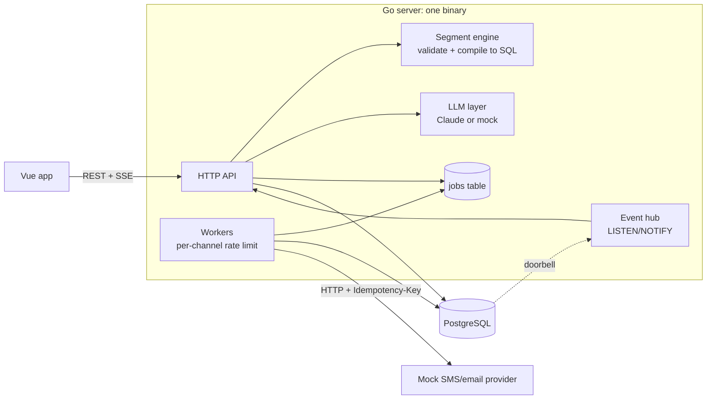

# Build plan

> **Status: complete.** This is the plan as written before coding, kept for reference. Phases 0–8 and the
> chosen bonus items (scheduled sending, CI, per-user language) are done; A/B variants were dropped. Where the
> build differs from the plan, [DECISIONS.md](../DECISIONS.md) and the README describe what was built.

The core flow comes first: brief → audience → messages → approval → sending → live dashboard. Every phase ends
with passing tests and something that runs. Bonus features start only after the core flow works end to end in
`docker compose up`.

## Architecture



Three containers: `postgres`, `app` (API, workers and the built Vue files, one origin so no CORS), `mockprovider`.

## Data model

| Table | Purpose | Key points |
| --- | --- | --- |
| `users` | ~5,000 seeded fake users (all mock data) | name, email, phone, city, language (`tr`/`en`, stored for later), `sms_consent`, `email_consent`, `last_cart_at`, `last_purchase_at`, `order_count`, `total_spent`, signup date |
| `campaigns` | One per brief | status, brief, segment rule (JSONB), message templates, counts, timestamps |
| `deliveries` | One per recipient × channel | `UNIQUE (campaign_id, user_id, channel)`, status, attempts, last error, provider message id (indexed, for webhooks) |
| `jobs` | Generic queue (done) | lease + `SKIP LOCKED`, `UNIQUE dedup_key`, `run_at` for retries and scheduling |
| `events` | Per-campaign event log (done) | replay after `Last-Event-ID` |

Campaign status: `draft → audience_ready → content_ready → approved → sending → completed` (plus `failed`).

## Segment rules: LLM output never becomes SQL

Claude returns a rule in a small JSON language, and the backend builds the query itself:

```json
{
  "match": "all",
  "conditions": [
    { "field": "city", "op": "eq", "value": "Istanbul" },
    { "field": "last_cart_at", "op": "within_days", "value": 30 },
    { "field": "last_purchase_at", "op": "not_within_days", "value": 30 }
  ]
}
```

Rules allow one level of nested groups. Structured outputs can't describe a recursive schema, so the depth is
fixed. The rule goes through four layers:

1. **Structured outputs** make Claude's response match the JSON schema.
2. **JSON Schema validation** on the backend (ported validator) checks shape and the limits the API can't
   enforce (number ranges, list sizes).
3. **Semantic checks**: only allowed fields, each field's own operators, types, known city names (İstanbul and
   Istanbul both match).
4. **The compiler** maps each field to a fixed column and SQL fragment. Values only ever go in as `$n`
   parameters.

**Repair loop:** if a check fails, the error goes back to Claude once. If it still fails, the user sees the
error and can edit the rule by hand.

**Preview:** the total audience, how many can be reached by SMS and by email (consent applied), and 5 sample
users.

## Messages

- **Language:** one per campaign. It defaults to the brief's language and the marketer can change it.
- **Variables:** `{{first_name}}`, `{{last_name}}`, `{{city}}`. Any other variable is rejected.
- **Length:** SMS ≤ 160 and email subject ≤ 80, checked after rendering against the longest real value in the
  audience, not just the template. The UI also shows the SMS encoding: Turkish characters force UCS-2, which
  allows only 70 characters per segment.
- **Streaming:** one Claude call returns `{sms, email_subject, email_body}` as streamed structured output. The
  backend pulls field values out of the partial JSON and sends `delta {field, text}` events. The UI fills each
  box live instead of showing raw JSON.
- **Edits:** the marketer's edits go through the same checks. If a message is too long, Claude can be asked to
  shorten it.

## Sending, retries and "never twice"

1. **Approve.** One transaction builds the audience SQL with the consent filter for each channel. It inserts the
   `deliveries` and `jobs` rows with set-based `INSERT … SELECT` and moves the campaign to `sending` with a
   conditional update. A second approve does nothing.
2. **Workers.** Each channel has its own job kind and worker pool. A `rate.Limiter` per channel caps sends at
   100/s. Leases are 30 s and jobs are short, so no heartbeat is needed. A sweeper requeues jobs whose lease
   expired.
3. **Retries.**
   - 429, 5xx, timeouts and network errors are retried with exponential backoff plus jitter (1 s base, 60 s
     cap), using `Retry-After` when the provider sends it. Up to 5 attempts, then the delivery is marked
     failed.
   - Other 4xx errors (e.g. an invalid number) fail at once.
4. **Never twice:** four separate layers.
   - The unique key on deliveries.
   - The job dedup key.
   - Only the worker holding the lease can move a delivery's status.
   - An `Idempotency-Key` (the delivery id) sent to the provider, which returns its earlier result for a repeat.
     This covers "the provider sent it but our worker crashed before saving that".
5. **Mock provider** (`cmd/mockprovider`, its own container). Each problem can be tuned with an environment
   variable:
   - random 500s
   - 429s with `Retry-After`
   - its own rate limit
   - 50–500 ms latency with occasional slow calls
   - 400 for malformed numbers or emails
6. **Delivery webhooks.**
   - A short while after accepting a message, the mock provider POSTs `delivered` or `undelivered` to
     `POST /webhooks/provider`. The body is signed with HMAC-SHA256 (shared secret, `X-Signature` header).
   - The provider retries a failed callback, and on purpose sends some callbacks twice, late, or before the
     worker has saved `sent`.
   - The app checks the signature and finds the delivery by provider message id.
   - It applies statuses in a fixed order (`sent` < `delivered`/`undelivered`), so duplicates and late callbacks
     can't move a delivery backwards.

## Live updates and tracking

- **One SSE stream per campaign.** It carries the content-generation deltas, status changes, and delivery
  counts per channel and status.
- **Counts on demand.** Workers only ring the doorbell. The stream re-counts at most every 500 ms, so 10,000
  deliveries don't mean 10,000 events.
- **Endpoints:**
  - `GET /healthz` (liveness)
  - `GET /readyz` (database ping)
  - `GET /metrics` (Prometheus: deliveries by channel and status, provider response codes and latency, queue
    depth, LLM calls and tokens)

## LLM layer

- **SDK and model:** the official Anthropic Go SDK, sitting behind the ported `Provider` interface. The default
  model is `claude-haiku-5-5`, configurable with `ANTHROPIC_MODEL`.
- **Effort:** low effort, since these are short tasks.
- **Server-side fallback:** on for models that support it (not Haiku), so a refusal is answered by a fallback
  model.
- **Retry:** the ported retry with `Retry-After`. The SDK's own retries are turned off so there's only one retry
  policy.
- **Mock LLM:**
  - Tests use the ported scripted fake.
  - With no API key, the app uses a keyword-based mock composer, so the demo works without a key.
  - With a key, the real Claude is used.

## Frontend (Vue 3, Vite, TypeScript, Tailwind v4, shadcn-vue, design tokens and fonts from my earlier project)

1. **Campaign list:** status, audience size, sent and failed counts.
2. **Composer (stepper):**
   - Brief.
   - Audience: the rule as readable chips with a JSON toggle, counts, sample users, edit or remove a
     condition, and a "refine" box.
   - Messages: a phone mock-up for the SMS and an email card, filled as they stream; character and segment
     counters; variables highlighted; preview as a sample user.
   - Approve: a confirmation showing exact counts. (Built as one "Send to N" button carrying the count.)
3. **Dashboard (live):** progress per channel, counts by status, throughput, retries, and a table of failed
   deliveries with their errors.

**Visual direction.** My earlier project's components and tokens on a white background, with thin grid lines and a bold
sans-serif display font for big headings. One pixel-art accent that carries data rather than decoration:

- **Delivery grid:** one square per delivery, coloured by status, filling in live:

  | Status | Colour |
  | --- | --- |
  | queued | light grey |
  | sending / retrying | yellow |
  | sent | blue |
  | delivered | navy |
  | undelivered / failed | red |

  Hovering a square shows the recipient and the last error.
- **Small extras:** a pixel logo mark and a pixel "thinking" animation while Claude streams.

Inspired by pixel-grid web design generally; no third-party logos, copy or characters are reused.

## Testing (`make test`: no API key, no Docker)

| Area | How |
| --- | --- |
| Segment validation + compiler | Table-driven: every operator, bad fields, injection-shaped values, consent filtering, the result checked against a real seeded DB |
| Message rendering + lengths | Variables, unknown variables, worst-case lengths, encoding |
| LLM adapter | `httptest` server playing Claude's SSE; structured-output parsing; retries on 429 |
| Partial-JSON field extractor | Chunk boundaries anywhere, escapes, Unicode |
| Queue | Dedup, retry/backoff, permanent failure, lease expiry, many workers never double-claim |
| End to end | Fake LLM + mock provider (errors and 429s): approve → every consenting user receives each message exactly once |
| API | `httptest` over the whole flow |
| Frontend | Vitest for the rule chips, SMS counter and stream composable |

## Phases

| # | Phase | Done when |
| --- | --- | --- |
| 0 | Infra port: database ✓, config, HTTP helpers, backoff, schema validator, event hub + SSE, queue | Tests pass |
| 1 | Data + seed: migrations, deterministic seeder (Turkish cities and names, realistic consent mix) | `make run` seeds 5,000 users once |
| 2 | Segment engine + preview endpoint | Rule → counts, fully tested |
| 3 | LLM layer + audience generation (repair loop, mock composer) | Brief → validated rule, with or without a key |
| 4 | Messages: templates, streaming generation, edits | Streamed, validated copy |
| 5 | Sending: approve, mock provider, workers, retries, metrics | E2E test: exactly-once delivery under errors |
| 6 | Live stream for the dashboard | Counts update live over SSE |
| 7 | Frontend | Whole flow in the browser |
| 8 | Packaging + docs: Dockerfile with web build, compose, README with diagram, DECISIONS, session export | `docker compose up` on a clean machine |
| 9 | Bonus, in order: scheduled sending (`run_at` already exists), CI, A/B variants, per-user language | — |

If time gets short, cut in this order: A/B variants, frontend tests, chip editing (keep "refine" only).

## Decisions taken

1. **One language per campaign.** Copy is written in the brief's language by default, and the marketer can pick
   another. Sending each user their own language stays a bonus item. (Later built: one translation per language.)
2. **Audience editing:** edit values or remove conditions on the rule chips, plus a "refine" box that sends an
   instruction back to Claude with the current rule. Every edit goes through the same validation.
3. **Delivery status comes from provider webhooks.** Statuses: `queued`, `sending`, `retrying`, `sent`
   (accepted), then `delivered` or `undelivered` from the webhook; `failed` when our sending gives up.
4. **All external data is mock data, kept minimal.** No event-history table: the seed sets the last cart and
   purchase dates on each user. Users' language is stored for a later "translate per user" step.
5. **Model:** `claude-haiku-5-5` by default for cheap manual testing, changeable with `ANTHROPIC_MODEL`.
